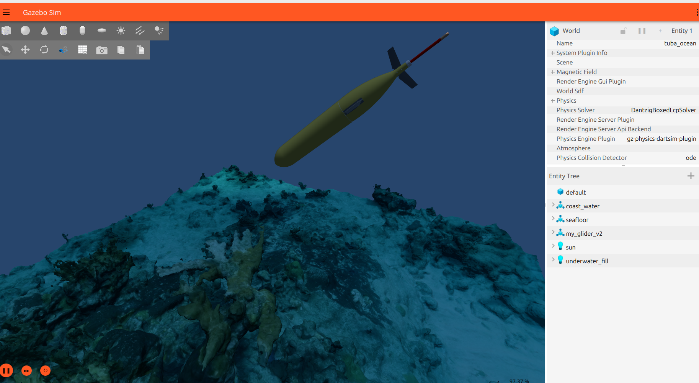

# TUBA Glider Simulation

Gazebo simulation of the [TUBA open-source underwater glider](https://hackaday.io/project/196850-tuba-the-open-source-glider), with the real Zephyr [tuba-firmware](https://github.com/e-abdi/tuba-firmware) running against it in software-in-the-loop (SIL).



## Models & Assets

- **Glider Hull**: TUBA shell converted to SDF using [FusionSDF](https://github.com/andreasBihlmaier/FusionSDF)
- **Water Surface**: [Coast Water](https://app.gazebosim.org/OpenRobotics/fuel/models/Coast%20Water) model from Gazebo Fuel
- **Seafloor**: [Coral Reef Outcrop](https://sketchfab.com/3d-models/coral-reef-outcrop-8bc72c9e4575470ea30d1313e48b730c) model from Sketchfab (run `unzip models/seafloor.zip "coral/seafloor/*" -d /tmp && mv /tmp/coral/seafloor models/` before launching)

## Prerequisites

| Tool | Version |
|------|---------|
| gz-sim | 10.6 (Gazebo Jetty) |
| Python | 3.10+ (3.14 on Ubuntu 26.04) |
| gz Python bindings | `python3-gz-transport15`, `python3-gz-msgs12` (mission script only; the SIL bridge is C++) |
| libgz-transport15-dev, libgz-msgs12-dev | SIL bridge |
| Zephyr workspace + SDK, `west` | firmware SIL build |
| python3-pexpect | `scripts/test_sil.py` |

## Project Layout

```
worlds/               Ocean world SDF (spawns my_glider_v2)
models/my_glider_v2/  The glider: Fusion CAD export + buoyancy engine, hydrodynamics, battery joint
models/tuba_glider/   Early cylinder-placeholder model (not spawned; kept for reference)
models/seafloor.zip   Coral seafloor mesh (unzip before launching, see above)
config/sil.cfg        SIL bridge settings (strokes, sensor placement, ports)
config/physics_params.yaml  Coefficient notes for the placeholder model
scripts/              Launch, mission and test scripts
bridge/               Gazebo ↔ firmware bridge (C++, gz-transport + UDP)
docs/sil.md           Real firmware in the loop: conventions, parameters, install notes
docs/fsd.md           Original design specification (partly superseded, see its header)
```

## Run the Simulation

```bash
# Launch Gazebo with the ocean world + glider
bash scripts/run_sim.sh

# Or with debug verbosity:
bash scripts/run_sim.sh 4
```

The glider spawns floating at the surface, ~70° nose-down with the antenna out of the water.

## Dive Mission

With the sim running, in a second terminal:

```bash
python3 scripts/glider_mission.py                 # repeat dive cycles forever
python3 scripts/glider_mission.py --cycles 1 --log /tmp/mission.csv
```

Each cycle: float at the surface (~70° nose-down, antenna out) → dive steeply (~75°) to 2 m
→ glide down at 30° nose-down to 10 m → turn buoyant and climb at 30° nose-up to 1 m
→ pitch over to ~75° nose-down and rise tail-first until the antenna is out again.
Depths, pitch, volumes and gains are all command-line options (`--help`).

## Manual Control

The world spawns `my_glider_v2`. Bladder volume range is 0–1.2 L (0.0005 = neutral).
Don't run manual commands while `glider_mission.py` is running; it overrides them.

`run_sim.sh` pins gz-transport to loopback (`GZ_IP=127.0.0.1`) so other terminals reliably
find the sim on machines with several network interfaces. Run `export GZ_IP=127.0.0.1` in any
terminal where you use `gz topic` / `gz service` (`glider_mission.py` sets it itself).

```bash
# Surface float (+1 N reserve; with battery fully forward floats ~70° nose-down)
gz topic -t /model/my_glider_v2/buoyancy_engine -m gz.msgs.Double -p "data: 0.0006"

# Glide down (-1.5 N) / glide up (+1.5 N)
gz topic -t /model/my_glider_v2/buoyancy_engine -m gz.msgs.Double -p "data: 0.00035"
gz topic -t /model/my_glider_v2/buoyancy_engine -m gz.msgs.Double -p "data: 0.00065"

# Battery (mass shifter), range -0.05..0.14 m, positive = toward the nose.
# Submerged pitch ~= atan((battery + 0.0195) / 0.0428), positive = nose-down:
#   -0.05 → ~35° nose-up, -0.0195 → level, 0.005 → 30° down, 0.14 → 75° down
gz topic -t /my_glider_v2/battery_joint_pos -m gz.msgs.Double -p "data: 0.005"

# Monitor bladder volume / joint positions
gz topic -e -t /model/my_glider_v2/buoyancy_engine/current_volume
gz topic -e -t /world/tuba_ocean/model/my_glider_v2/joint_state
```

## Legacy scripts

`scripts/test_buoyancy.sh`, `scripts/test_glider_cycle.sh` and
`scripts/plot_trajectory.py` are from the first phase of the project and target
the placeholder model `tuba_glider`, which the world no longer spawns. Use
`glider_mission.py` (above) or the SIL loop (below) instead; `glider_mission.py` and
`run_sil.sh` both write a CSV trajectory with `--log`.

## Real firmware in the loop (SIL)

The [tuba-firmware](https://github.com/e-abdi/tuba-firmware) builds as a Linux
process and flies this glider: its menus, parameters and missions are unchanged,
the pump/pitch motors move the Gazebo model and the sensors read the model's
pose. Full description, conventions and parameter values: [docs/sil.md](docs/sil.md).

```bash
bash scripts/build_bridge.sh                 # once: Gazebo <-> firmware bridge (C++)
cd ~/zephyrproject/tuba && ./sil_build.sh    # once: firmware for native_sim

bash scripts/run_sim.sh                      # terminal 1: Gazebo, press Play
bash scripts/run_sil.sh                      # terminal 2: bridge
~/zephyrproject/tuba/sil_run.sh              # terminal 3: glider console (ENTER -> menu)

python3 scripts/test_sil.py                  # headless end-to-end check (~3 min)
```

## Physics Tuning

All physics lives in the plugin blocks at the end of `models/my_glider_v2/model.sdf`
(restart gz sim after each change):

- `BuoyancyEngine` — bladder range 0–1.2 L, `neutral_volume` 0.5 L
- `Hydrodynamics` — Fossen added mass and drag, applied at `hydro_link` (hull
  centre). `xUabsU` sets axial drag and so the glide speed.
- `hull_seg_*` collision cylinders — the displaced volume. The hull is cut into
  ten short segments so graded buoyancy behaves at the surface.
- Battery joint limits −0.05…0.14 m — the pitch authority.

If you change the bladder range or the battery travel, update `config/sil.cfg`
to match, otherwise the firmware's stroke seconds map to the wrong positions.

## Known Issues / Open Items

1. Hydrodynamic coefficients are analytical estimates, not yet fitted to tank or sea data.
2. The battery travel (−0.05…0.14 m) is estimated from the CAD, not measured on the hardware.
3. The Gazebo model has no roll mass: the firmware's heading hold moves a tracked-only roll position.
4. Hardware-in-the-loop (ESP32 over WiFi against the same bridge) is designed for but not built, see [docs/sil.md](docs/sil.md).
